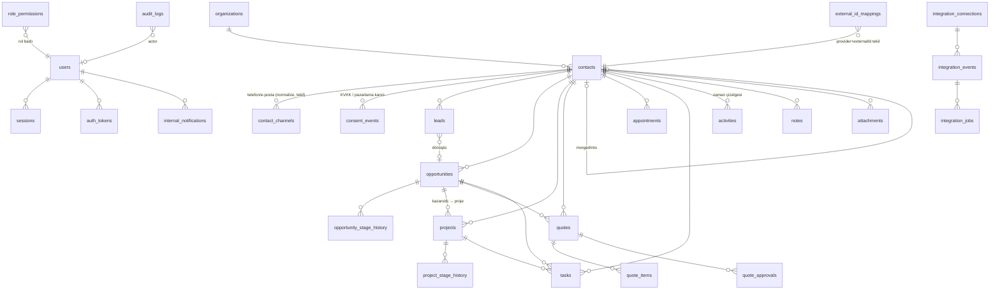

# Veri Modeli (ERD) ve API Taslağı

Kaynak gerçek: `prisma/schema.prisma`. Tüm birincil anahtarlar `uuid v7`, tüm zamanlar `timestamptz`, tarih-yalnız alanlar `date`. Kayıt numaraları: Müşteri `M-`, Fırsat `F-`, Proje `P-`, Teklif `T-` + 6 hane.

## ERD (çekirdek)

### Kritik kısıtlar
- `contact_channels (contactId, type, normalized)` tekil; telefon E.164, e-posta küçük harf.
- `leads (source, sourceSubmissionId)` tekil → web gönderimi idempotent.
- `integration_events (provider, externalEventId)` tekil → webhook tekrarı işlenmez.
- `webhook_nonces (nonce)` birincil anahtar → imzalı isteğin birebir tekrarı reddedilir; süresi geçenleri worker siler.
- `internal_notifications (userId, dedupeKey)` tekil → aynı hatırlatma iki kez gitmez.
- `opportunities.contactId` / `projects.contactId` / `quotes.contactId` → `RESTRICT` (müşteri silinirse iş kaydı kopmaz; müşteri yalnız arşivlenir `deletedAt`).
- `pg_trgm` GIN indeksi `contacts.fullName` üzerinde (bulanık arama).
- Para: `Decimal(14,2)` + `currency`.

## Sunucu action'ları (UI → sunucu)

Tümü: oturum + `requirePermission` + satır kapsamı (`scope.ts`) + Zod doğrulama + denetim kaydı.

| Modül | Action | İzin |
|---|---|---|
| Kimlik | `login`, `verifyMfa`, `logout`, `requestPasswordReset`, `setPassword` | — (hız sınırlı) |
| Talepler | `quickIntakeAction` (bekleyen talep için `leadId`), `discardLead` | `leads.process` |
| Müşteriler | `createContactAction`, `updateContactAction`, `archiveContactAction`, `mergeAction` | `contacts.create/edit/archive/merge` |
| Fırsatlar | `createOpportunityAction`, `updateOpportunityAction`, `moveOpportunityAction` (kanban), `changeStageAction`, `archiveOpportunityAction`, `createProjectAction` | `opportunities.*`, `projects.create` |
| Projeler | `updateProjectAction`, `projectStageAction`, `approveDatesAction` | `projects.edit`, `projects.approve_dates` |
| Kayıt ortak | `addNote`, `toggleNotePin`, `deleteNote`, `logActivity`, `saveTask`, `changeTaskStatus`, `removeTask`, `uploadFiles`, `deleteFile` | `notes.write`, `tasks.manage`, `files.upload` |
| Kullanıcılar | `inviteUser`, `resetLink`, `updateUser`, `revokeSessionsAction`, `savePermissions` | `users.manage`, `roles.manage` |
| Ayarlar | `changePassword`, `startMfa`, `confirmMfa`, `disableMfa`, `cancelMfaSetup`, `revokeSession`, `toggleEmailNotifications` | kendi hesabı |
| Ayarlar | `saveWebsiteOwner` (web talepleri otomatik sorumlusu, `settings.intake.website_owner_id`) | `settings.manage` |
| Entegrasyon | `retry` (iş kuyruğu) | `integrations.manage` |

## HTTP uç noktaları

| Yöntem | Yol | Açıklama | Durum |
|---|---|---|---|
| GET | `/api/health` | DB erişimi + sürüm (sır içermez) | Faz 1 ✓ |
| GET | `/api/files/{id}?v=&exp=&sig=` | HMAC imzalı (kullanıcıya bağlı, süreli) + oturum + kayıt erişimi; indirme denetlenir | Faz 1 ✓ |
| GET | `/api/export/{contacts\|opportunities\|projects\|tasks\|audit}` | CSV (BOM, `;`, formül enjeksiyonu koruması); `export.data` izni + hız sınırı + denetim | Faz 1 ✓ |
| POST | `/api/v1/intake/website` | Site → CRM form başvurusu (JSON, fotoğraf base64 aynı gövdede, en fazla 3 × 10 MB). Başlıklar: `X-Bifire-Timestamp` (unix sn, ±5 dk), `X-Bifire-Nonce` (16–64 `[A-Za-z0-9_-]`, `webhook_nonces` ile tekrar reddi → 409), `X-Bifire-Signature` = `v1=` + hex(HMAC-SHA256(secret, `ts.nonce.rawBody`)). Yanıt: 202 yeni / 200 `duplicate:true` / 401 imza / 413 / 422 / 503 yapılandırılmadı | Faz 2 ✓ |
| POST | `/api/v1/intake/website/status` | Mutabakat: `{ submissionIds: [...] }` → `{ received: [...] }` (yalnız kimlik, kişisel veri yok). Aynı imza kuralları | Faz 2 ✓ |
| GET/POST | `/api/v1/webhooks/meta` | Meta Lead Ads / Instagram / WhatsApp Cloud (doğrulama token + `X-Hub-Signature-256`) | Faz 4 |
| GET | `/api/v1/oauth/google/callback` | Google Calendar bağlantısı (state + PKCE) | Faz 4 |

Hata biçimi (tüm JSON uç noktaları): `{ "error": { "code": "invalid_signature", "message": "…" } }`.
